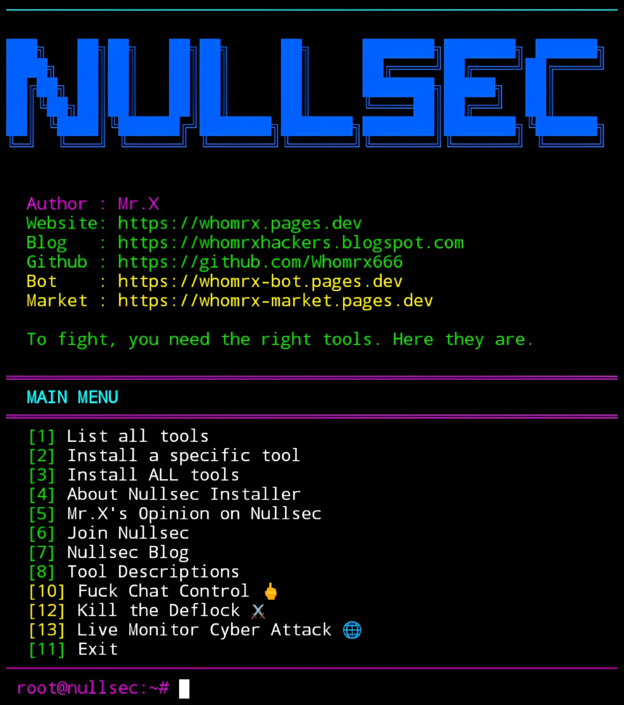

# Nullsec Installer


<p align="center">
  <strong>300+ Hacking Tools Installer – Cyberpunk Neon Edition</strong><br>
  <em>"To fight, you need the right tools. Here they are." – Mr.X</em>
</p>

## Introduction
Nullsec Installer is a powerful Python-based tool installer designed for Linux and Termux users. It integrates **300+ popular penetration testing, OSINT, exploitation, and forensics tools** directly from their original GitHub repositories. With a futuristic cyberpunk neon interface, Nullsec makes it easy to browse, install, and manage a vast arsenal of security tools—all with a single command. It also includes extra features like freedom tools, live cyber attack monitoring, and anti surveillance resources. Nullsec runs smoothly on **Termux (Android)**, Linux, and any Unix-like environment—**no root required**.

## Installation
```bash
$ pkg update -y && pkg upgrade -y
$ pkg install git python -y
$ git clone https://github.com/Whomrx666/Nullsec.git
$ cd Nullsec
$ python3 install.py
```

## Run manually
```bash
$ python3 nullsec.py
```

## Features
- **300+ Tools** – Metasploit, Nmap, SQLMap, Hydra, Aircrack-ng, Wifite, Bettercap, BeEF, Zphisher, and many more.
- **Direct GitHub Cloning** – Each tool is cloned from its original repository.
- **Tool Descriptions** – View detailed descriptions for every tool.
- **Single or Bulk Installation** – Install one tool or all 300+ at once.
- **Freedom Tools** – Discover privacy-focused apps (Signal, Element, Briar, Session, etc.).
- **Kill the Deflock** – Learn about Deflock surveillance and locate it on a map.
- **Live Cyber Attack Monitor** – View realtime cyber attacks via Kaspersky Cybermap.
- **Cyberpunk UI** – Neon colors, matrix effect, loading animations, and a red/white ASCII banner.
- **Termux Optimized** – Works flawlessly on Android without root.
- **No Root Required** – Uses standard Python and Git.

## Menu Options
| #  | Option | Description |
|----|--------|-------------|
| 1  | List all tools | Browse 300+ tools with pagination |
| 2  | Install a specific tool | Clone a single tool by number |
| 3  | Install ALL tools | Clone all 300+ tools |
| 4  | About Nullsec Installer | Information about the tool |
| 5  | Mr.X's Opinion on Nullsec | Author's perspective |
| 6  | Join Nullsec | Open Nullsec website |
| 7  | Nullsec Blog | Open Nullsec blog |
| 8  | Tool Descriptions | View detailed descriptions of tools |
| 10 | Fuck Chat Control | Freedom tools against chat control |
| 12 | Kill the Deflock | Information and map for Deflock |
| 13 | Live Monitor Cyber Attack | Kaspersky Cybermap |
| 11 | Exit | Quit the program |

## Instructions
1. **Install** the tool using the commands above.
2. **Run** `python3 nullsec.py` to start.
3. **Browse tools** – Use option 1 to list all available tools.
4. **Install a single tool** – Use option 2 and enter the tool number.
5. **Install all tools** – Use option 3 (this will take a long time and require disk space).
6. **View descriptions** – Use option 8 to learn what each tool does.
7. **Explore extra features** – Options 10, 12, and 13 provide freedom tools and live attack maps.
8. **Exit** – Use option 11 or press Ctrl+C anytime.

## Observation
This tool is intended for **educational and authorized security testing purposes only**. All tools are cloned from public GitHub repositories and are the property of their respective owners. Unauthorized use of these tools against systems you do not own or have explicit permission to test is illegal. The author assumes no responsibility for misuse or damage caused by this tool.

### Original Author
<a href="https://github.com/Whomrx666"></a>

### <<< If you copy, then give me the credits >>>

## CONNECT WITH ME :

[](https://whomrx.pages.dev) <br>
[](https://whomrxhackers.blogspot.com) <br>
[](https://twitter.com/whomrx666) <br>
[](https://wa.me/6285926601133?text=Halo%2C%20Mr.X) <br>
[](https://www.facebook.com/whomrx.666) <br>
[](https://t.me/Whomr_X) <br>
[](mailto:whomrx666@gmail.com) <br>
[](https://www.tiktok.com/@whomr.x)

**If you want to donate, click on the button**
<a href="https://saweria.co/whomrx"></a>

---

<p align="left">
  
</p>